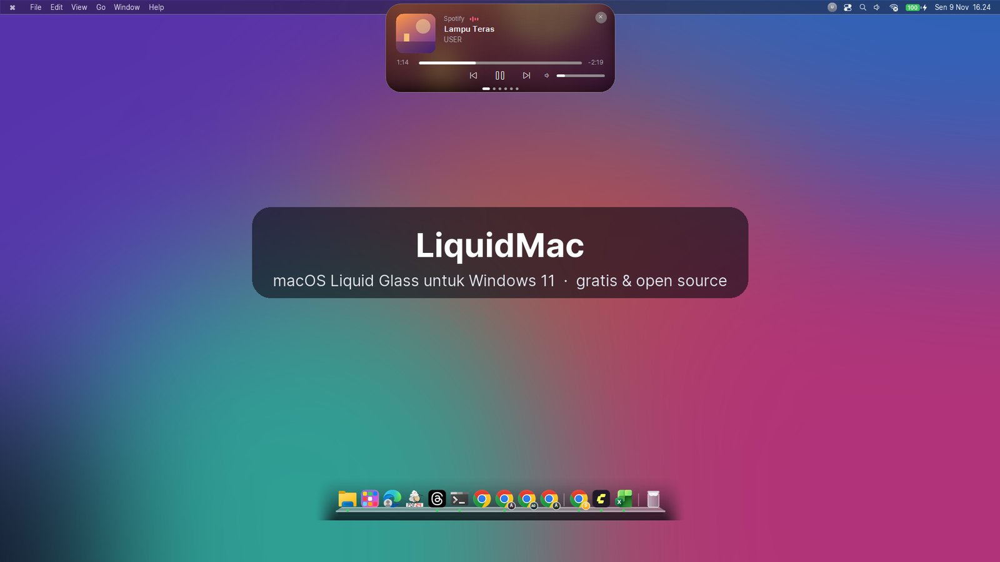
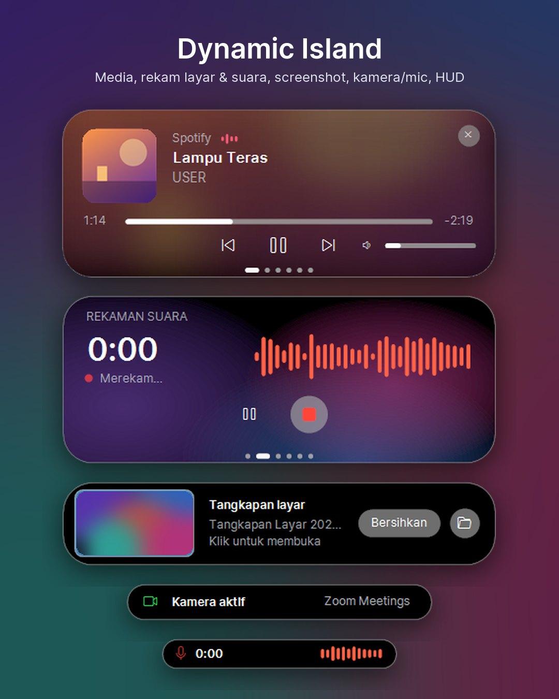

# LiquidMac

[](https://github.com/amarashaff/LiquidMac/releases/latest)
[](https://saweria.co/aashaf)

**Windows 11 rasa macOS.** LiquidMac menambahkan menu bar, Dynamic Island, Dock, Launchpad, dan tombol jendela "traffic light" gaya macOS (Liquid Glass) ke Windows 11. Gratis, open source, satu berkas `.exe` (sekitar 5 MB), dan hemat RAM (sekitar 50 MB).



---

## Cara pasang

### Cara 1: satu perintah (disarankan)

1. Tekan tombol **Windows**, ketik **PowerShell**, lalu buka **Windows PowerShell**. Tidak perlu "Run as administrator".
2. Salin perintah di bawah, tempel di PowerShell (klik kanan = tempel), lalu tekan **Enter**:

   ```powershell
   irm https://raw.githubusercontent.com/amarashaff/LiquidMac/main/install.ps1 | iex
   ```

3. Kalau ditanya **"Pasang juga Explorer transparan?"**, ketik `y` lalu Enter bila mau. Opsi ini butuh izin admin. Bila tidak mau, cukup tekan Enter.
4. Selesai. LiquidMac langsung berjalan dan akan aktif otomatis setiap Windows menyala.

Pemasang ini mengunduh versi terbaru ke `%LOCALAPPDATA%\Programs\LiquidMac`, membuat pintasan **LiquidMac** di menu Start, dan mengaktifkan jalan otomatis.

### Cara 2: unduh exe

1. Buka halaman **[Releases](https://github.com/amarashaff/LiquidMac/releases/latest)**, lalu unduh `LiquidMac.exe`.
2. Pindahkan ke folder tetap, misalnya `C:\Users\<nama>\LiquidMac\`. Jangan dijalankan dari folder Unduhan yang sering dibersihkan.
3. Klik dua kali `LiquidMac.exe`. Saat pertama kali dijalankan, jendela **Pengaturan** terbuka dan jalan otomatis langsung aktif.

### Syarat

- Windows 11 (diuji di 24H2/25H2). Di Windows 10 sebagian fitur tidak berjalan.
- .NET Framework 4.8, yang sudah bawaan Windows 11. Tidak perlu memasang apa-apa lagi.

---

## Setelah terpasang

| Ingin… | Caranya |
|---|---|
| Membuka **Pengaturan** | Menu Start → **LiquidMac**, atau klik ikon LiquidMac di system tray (pojok kanan bawah) |
| Menyalakan/mematikan fitur | Semua fitur ada sakelarnya di Pengaturan |
| Membuka **Launchpad** | Tekan tombol **Windows** (Start bawaan tetap bisa dengan `Ctrl+Esc`) |
| Membuka **Dynamic Island** | Arahkan kursor ke pil hitam di tengah atas layar, atau klik |
| Menyimpan aplikasi ke Dock | Klik kanan ikonnya di Dock → **Simpan di Dock**, atau klik kanan di Launchpad → **Tambahkan ke Dock** |
| Menyimpan profil Chrome tertentu ke Dock | Klik kanan ikon Chrome → **Simpan profil … di Dock** |
| Memperbarui | Otomatis. LiquidMac memeriksa versi baru beberapa jam sekali. Bisa juga lewat Pengaturan → **Periksa pembaruan** |
| Keluar sementara | Klik kanan ikon tray → **Keluar** |

---

## Fitur



**Dynamic Island**
- Kartu yang bisa digeser: media (YouTube, Spotify, dan lain-lain), jam & statistik sistem, rekam, notifikasi, timer, cuaca.
- Latar gradasi warna yang bergerak lembut saat island dibuka (ala Apple Music).
- **Rekam layar** (MP4, opsional dengan mikrofon) dan **rekam suara** (M4A) dengan gelombang suara ala iPhone.
- Pratinjau **tangkapan layar** (Win+PrtScn / Snipping Tool) dengan tombol Bersihkan.
- Notifikasi saat aplikasi memakai **kamera** (hijau) atau **mikrofon** (oranye).
- HUD volume, kecerahan, dan pengisian daya menggantikan pop-up Windows.
- Animasi lucu saat diam (pusaran air / detak jantung), dan mode island tersembunyi yang muncul saat disentuh kursor.

**Dock**
- Aplikasi tersemat dan semua aplikasi yang sedang berjalan, termasuk aplikasi Store (Media Player, Settings, dan lain-lain).
- Pembesaran halus, titik aplikasi aktif (warnanya bisa dipilih), papan kaca, dan efek memantul saat membuka aplikasi.
- Profil Chrome/Edge/Brave bisa disimpan sendiri-sendiri dengan badge inisial profil.

**Jendela**
- **Traffic light** merah/kuning/hijau menggantikan tombol jendela Windows di semua aplikasi, termasuk aplikasi Electron (VS Code, Discord, dan sejenisnya).
- Animasi minimize **genie** yang tersedot ke balik ikon Dock, atau opsi **Kantong Ajaib**, lengkap dengan suara lembut.

**Launchpad**
- Semua aplikasi, pencarian, kategori **Sering dipakai** & **Terakhir dibuka**, animasi bergelombang, dan navigasi keyboard.

**Gaya macOS menyeluruh**
- Menu bar dengan panel Wi-Fi, suara, baterai (persentase + petir saat dicas), dan Control Center buatan sendiri.
- Font Inter (mirip SF Pro), kursor macOS, layar kunci dari wallpaper, panel profil & info sistem, notifikasi, dan suara sistem gaya macOS.
- Semua bisa dikembalikan ke tampilan Windows asli kapan saja.

---

## Masalah umum

- **"Windows protected your PC" (SmartScreen)**: exe belum ditandatangani secara digital. Klik **More info → Run anyway**.
- **Antivirus memblokir**: tambahkan `LiquidMac.exe` ke pengecualian. LiquidMac tidak mengirim data apa pun. Ia hanya memeriksa pembaruan di GitHub dan cuaca dari wttr.in (bisa dimatikan).
- **Rekaman tidak tersimpan di Videos/Music**: bila *Controlled Folder Access* Defender aktif, rekaman otomatis disimpan ke folder **Unduhan**.
- **Ada yang terasa aneh?** Matikan fiturnya lewat Pengaturan, atau laporkan di [Issues](https://github.com/amarashaff/LiquidMac/issues).

---

## Copot

Buka PowerShell, lalu jalankan:

```powershell
irm https://raw.githubusercontent.com/amarashaff/LiquidMac/main/uninstall.ps1 | iex
```

Perintah ini mengembalikan font, kursor, layar kunci, suara, ikon, taskbar, dan notifikasi Windows, lalu menghapus LiquidMac.

---

## Dukung pengembangan

LiquidMac gratis. Kalau bermanfaat, traktir pengembangnya lewat **[Saweria](https://saweria.co/aashaf)** (QRIS, GoPay, OVO, DANA, transfer bank). ☕

## Build sendiri

Tidak perlu Visual Studio: cukup .NET Framework 4 yang sudah ada di Windows. Jalankan `build.bat`; hasilnya `LiquidMac.exe` di folder yang sama.

## Catatan & lisensi

- Ikon, suara, animasi, dan grafik dibuat sendiri oleh program. Tidak ada aset milik Apple.
- Font [Inter](https://github.com/rsms/inter) oleh Rasmus Andersson (SIL OFL 1.1, lihat `assets/fonts/OFL.txt`).
- Kursor dari [apple_cursor](https://github.com/ful1e5/apple_cursor) oleh Abdulkaiz Khatri (GPL-3.0, lihat `assets/cursors/LICENSE`), disertakan apa adanya.
- ExplorerBlurMica adalah proyek terpisah milik Maplespe (LGPL-3.0); pemasang hanya mengunduhnya dari rilis resmi.
- Layar kunci asli Windows berjalan di desktop aman yang tidak bisa ditimpa aplikasi, jadi yang diganti adalah gambarnya.

Lisensi kode: [MIT](LICENSE)
